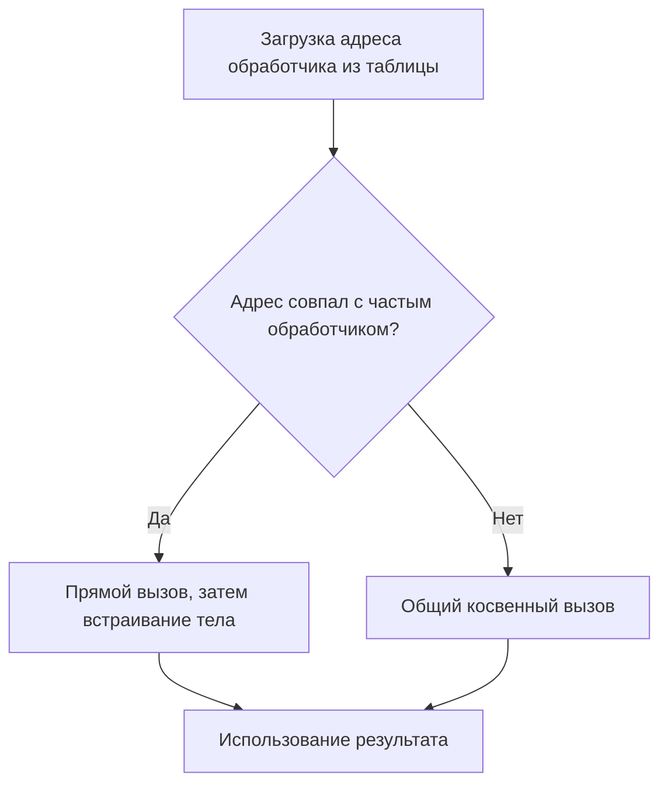

# Оптимизация диспетчеризации 4П по профилю выполнения

Эксперимент показывает, как стандартный LLVM использует реальные частоты
косвенных вызовов для оптимизации диспетчеризации 4П. Проход
`pgo-icall-prom` создаёт проверку адреса частого обработчика, прямой вызов на
соответствующем пути и общий косвенный вызов для остальных случаев.

Генерация вызовов в ppchibicc сохраняет существующую семантику. Преобразование
выполняется внешним `opt`, а открытый набор специализаций проверяется отдельным
объектным модулем, который отсутствовал при сборе профиля.

## Запуск и зависимости

Нужны LLVM/Clang 23 или новее, `llvm-as`, `opt`, `llc`, `llvm-link`,
`llvm-profdata` и библиотека профилирования compiler-rt. Major-версии всех
инструментов должны совпадать. Проверено на Clang/LLVM 23.1.6, Linux x86-64.

```sh
cmake -S . -B build-llvm23 -DCMAKE_C_COMPILER=clang -DPPCHIBICC_LLVM_VERSION=23
cmake --build build-llvm23 --target llvm-pgo-demo
cat build-llvm23/llvm-pgo-demo/report.md
```

Альтернатива: `make llvm-pgo-demo BUILD_DIR=build-llvm23`.
Для нестандартных путей дополнительно доступны параметры CMake
`PPCHIBICC_LLVM_PROFDATA` и `PPCHIBICC_LLVM_CLANG`; пути к остальным инструментам
задаются так же, как для предыдущих экспериментов.

Clang нужен для линковки обучающего исполняемого файла с compiler-rt.
Исходники 4П обрабатывает ppchibicc. Системным C-компилятором для обычной
линковки может быть Clang или GCC.

Если при линковке обучения не найден `libclang_rt.profile`, нужен пакет
compiler-rt для используемой версии Clang. В Debian/Ubuntu это, например,
`libclang-rt-23-dev`. Диагностика сохраняется в `training/link.stderr`, а
команда линкера при успешной сборке — в `training/link-command.txt`.
Остальные цели проекта не требуют библиотеки профилирования.

## Программа и границы профилирования

Исходники — [examples/llvm/pgo](../examples/llvm/pgo).
Обобщение `Shape` содержит общий счётчик `visits`. Первоначальные
специализации — прямоугольник с результатом 10 и квадрат со стороной 3.

| Режим первого аргумента | Два чередующихся объекта |
| --- | --- |
| 0 | Прямоугольник и прямоугольник; обучение |
| 1 | Квадрат и квадрат |
| 2 | Прямоугольник и квадрат; режим по умолчанию |
| 3 | Расширение `growing` и прямоугольник |
| 4 | Расширение `switching` и прямоугольник |
| 5 | Нулевая специализация и прямоугольник |

`dispatch_many` выбирает по очереди два обобщённых указателя и вызывает
`compute<shape>()`. При обучении оба указателя указывают на прямоугольник:
4096 итераций дают 4096 вызовов одного обработчика и сумму 40960.

Профилируемый модуль объединяет только `base.bc` и `handlers.bc`.
`main.o` собран отдельно без профилирования. Поэтому обучение выполняется
на публичной функции `dispatch_many`, а последующая оптимизация не встраивает
в неё заранее известные аргументы из `main`.

Во время обучения подключается `stub.o`, возвращающий отсутствие расширения.
При проверке нового набора вместо него линкуется `extension.o`. Основной
PGO-объект и вызывающий `main.o` переиспользуются. Символы не скрываются
через `internalize`, и расширение не включается в оптимизируемый IR ядра.

## Сбор и использование профиля

Используется IR-based PGO. Инструментирование выполняет стандартный pipeline:

```sh
opt -mcpu=x86-64 -pgo-kind=pgo-instr-gen-pipeline \
  -passes='default<O2>' -verify-each input/core.bc -o training/core.bc
```

Далее `llc` создаёт объект, а Clang линкует его с `main.o`, `stub.o` и
библиотекой профилирования через `-fprofile-generate`. Обучающий запуск задаёт
`LLVM_PROFILE_FILE` и аргументы `0 4096`.

Для каждого запуска цели создаётся новая директория профиля. В `merge`
передаётся ровно один полученный `.profraw`, поэтому старые результаты не
участвуют в следующем эксперименте:

```sh
llvm-profdata merge rectangle.profraw -o training/profile.profdata
llvm-profdata show --function=dispatch_many --counts --ic-targets \
  training/profile.profdata
```

В прогоне LLVM 23.1.6 зафиксировано:

```text
[  0, __ppc_compute_Shape_rectangle, 4096 ] (100.00%)
```

Этот профиль применяется к исходному `input/core.bc`, из которого началось
обучение:

```sh
opt -mcpu=x86-64 -pgo-kind=pgo-instr-use-pipeline \
  -profile-file=training/profile.profdata -passes='default<O2>' \
  -verify-each input/core.bc -o PGO/core.bc
```

Для сравнения из того же исходного bitcode создаётся обычный O2-вариант.
Настройки `llc` одинаковы: `-O=2 -mcpu=x86-64 -relocation-model=pic`.
Объекты создаются через `-filetype=obj`; ассемблерные листинги сохраняются
для изучения. Готовые O2- и PGO-программы линкуются обычным C-компилятором
без библиотеки профилирования.

## Что изменилось в IR

LLVM 23.1.6 сообщает одно продвижение вызова в `dispatch_many`: целевой
обработчик `__ppc_compute_Shape_rectangle`, частота 4096 из 4096.
Сообщение прохода сохранено в `PGO/promotion.yaml`.

Схема преобразования:



В IR сразу после `pgo-icall-prom` видны проверка адреса и прямой вызов.
В конечном O2-коде тело прямоугольника уже встроено: на частом пути остаётся
загрузка его поля. Общий путь содержит исходный косвенный вызов.

| `dispatch_many` | Инструкции IR | `load` | Прямые вызовы | Косвенные вызовы |
| --- | ---: | ---: | ---: | ---: |
| Обычный O2 | 27 | 4 | 0 | 1 |
| PGO + O2 | 37 | 6 | 0 | 1 |

Число косвенных точек вызова остаётся равным одному: сохранён общий путь.
Нулевой счётчик прямых вызовов отражает встраивание обработчика. Добавление
проверки увеличивает статический размер функции. Эти числа описывают IR;
ускорение и время выполнения здесь не измеряются.

## Проверки на данных вне профиля

Обучение использует только прямоугольник. Обычный O2, PGO и нативный backend
проверяются по фиксированным результатам из `common.cases` и `extension.cases`:

- только прямоугольники, только квадраты и смешанные вызовы;
- нулевая специализация с общим обработчиком, отсутствовавшим в обучении;
- нулевое число итераций, несколько ненулевых значений и запуск по умолчанию;
- новая специализация `growing`, которая увеличивает `visits` и своё значение;
- новая специализация `switching`, которая меняет данные и через `init_spec`
  переключает объект на существующий обработчик прямоугольника;
- ошибки аргументов и отсутствие расширения в базовой сборке.

Все специализации расширения имеют одинаковую с прямоугольником вместимость
и выравнивание. При смене специализации сохраняются общее поле и значение
payload. Числовые runtime-индексы в проверках не фиксируются.

Для 7 итераций расширенный PGO-вариант даёт:

```text
mode=3 n=7 sum=43.00 visits=4 retagged=0
mode=4 n=7 sum=40.00 visits=1 retagged=1
```

Первый обработчик изменяет объект при каждом своём вызове. Второй вызывается
один раз, после чего последующие обращения к этому объекту выбирают
прямоугольник. Это проверяет сохранение поведения при изменении состояния и
специализации внутри цикла. Квадрат и обе новые специализации в профиле
обучения отсутствуют.

Процент 100% относится к обучающему запуску. Профиль задаёт частоты для
выбора оптимизаций и не ограничивает допустимые специализации программы.

## Сохранённые материалы

В `build-llvm23/llvm-pgo-demo` находятся:

- `source/`, `input/`: копии исходников, исходные модули и общий `core.bc`;
- `objects/`: отдельные main/stub/extension и нативные объекты;
- `training/`: инструментированное ядро, обучающий исполняемый файл,
  `.profraw`, `.profdata`, команды и вывод профиля;
- `O2/`, `PGO/`: bitcode, полный IR, ассемблер, объект и фрагмент `dispatch_many`;
- `baseline/`, `extended/`: исполняемые файлы и проверки результатов;
- `manifest.txt`, `metrics.tsv`, `report.md`: версии, параметры, контрольные
  суммы и статические счётчики.

`PGO/icp.log` содержит диагностические фрагменты функции до и после
продвижения. Они не являются отдельными модулями LLVM. Полный `PGO/core.ll`
печатается из bitcode отдельной командой без фильтра диагностической печати
и проверяется обратной сборкой через `llvm-as`.

Для изучения результата:

```sh
cat build-llvm23/llvm-pgo-demo/training/dispatch-profile.txt
cat build-llvm23/llvm-pgo-demo/PGO/promotion.yaml
cat build-llvm23/llvm-pgo-demo/PGO/dispatch_many.txt
build-llvm23/llvm-pgo-demo/extended/PGO.exe 4 7
```

Цель `llvm-pgo-bench` использует готовые объекты этого эксперимента для
[измерения времени на четырёх контрольных нагрузках](llvm-pgo-benchmark-ru.md).
Она отдельно оценивает совпадение с профилем, другой обработчик, смешанный
набор и изменяющее данные расширение. Перенос результата на прикладную
программу требует её собственного обучающего и контрольного наборов.
